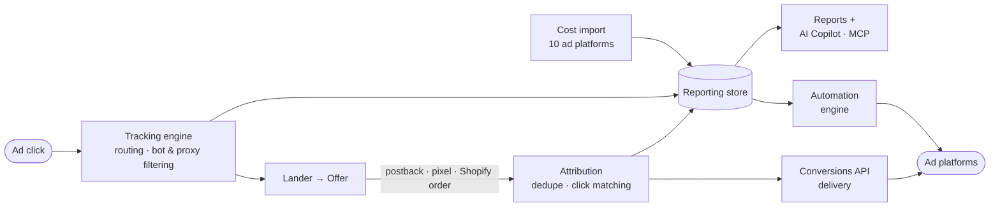

 

---

I build the systems that tell marketers which clicks made money. For the past year that has meant designing and shipping **[Nitoriq](https://nitoriq.com)** on my own: a tracking, attribution and automation platform in the same category as Voluum, RedTrack and ClickFlare. I take the same work on for clients: conversion tracking, server-side events, Shopify attribution and the full-stack apps around them.

## Nitoriq

| Area | What I built |
|---|---|
| **Click tracking** | Redirect and redirectless tracking, custom domains with DNS verification, conditional routing on geo, ASN, device, proxy, bot score, time of day and more (AND/OR, regex), weighted rotation, offer caps |
| **Attribution** | Postback and pixel conversions deduplicated by transaction ID, lander-journey attribution, multi-currency with automatic FX conversion, 20 custom tracking fields |
| **Integrations** | Cost import from Google Ads, Meta, TikTok, Snapchat, Pinterest, Reddit, Taboola, Outbrain, Revcontent, MGID. Server-side conversions to Meta, Google Ads, TikTok, Snapchat, Pinterest, Reddit. Revenue from ClickBank, Everflow, impact.com, Rakuten, Partnerize, AdSense |
| **Shopify** | Embedded app with a Web Pixel and order webhooks. Matches each order back to its click with a confidence score and the evidence behind it, net of refunds |
| **Tag manager** | Versioned containers, GA4 / Meta / Google Ads / TikTok tags, SPA, scroll and visibility triggers, dataLayer support, consent handling, pixel + CAPI dedupe |
| **Automations** | Rules that pause, scale budgets, adjust bids and exclude placements across 7 ad platforms. Every rule can be simulated first and runs behind cooldowns, spend caps and read-back verification |
| **AI Report Copilot** | Reads the report on screen, explains what changed and flags wasted spend. Also exposed to outside AI agents through an MCP server with OAuth and approval-gated writes |
| **Reporting & API** | 3-level drill-down, formula metrics, saved views, shared links. REST API with OpenAPI spec, scoped keys and service principals (RS256 JWT) |

**Engineering choices I'm proud of**

- Redirects never wait on the database. Ingest is async, so a slow write can't slow down an ad click.
- Browser pixels and server-side events share an event ID, so ad platforms count each conversion once.
- Before an automation touches a live campaign, it checks provider health, data freshness and campaign mapping confidence, then reads the change back to confirm it landed.

**Stack:** pnpm monorepo (app, API, docs, help center, Shopify app) · React · TypeScript · Express · PostgreSQL · ClickHouse · Redis · Docker

## Work with me

- **Conversion tracking and CAPI:** GTM, GA4, server-side GTM, Meta Conversions API, event matching and deduplication
- **Tracker setup and migration:** Nitoriq, Voluum, RedTrack, ClickFlare, with postbacks, cost import and campaign structure
- **Shopify:** tracking audits, attribution fixes, custom themes, embedded apps
- **Full-stack:** TypeScript, React, Node.js, PostgreSQL, Redis, WordPress, n8n automations

## Tools

  

  
  
  
  
  
  

<!-- Snake animation: generated by .github/workflows/snake.yml into the "output" branch -->
<picture>
  <source media="(prefers-color-scheme: dark)" srcset="https://raw.githubusercontent.com/Torpedo4007/Torpedo4007/output/github-snake-dark.svg?v=2" />
  <source media="(prefers-color-scheme: light)" srcset="https://raw.githubusercontent.com/Torpedo4007/Torpedo4007/output/github-snake.svg?v=2" />
  
</picture>

